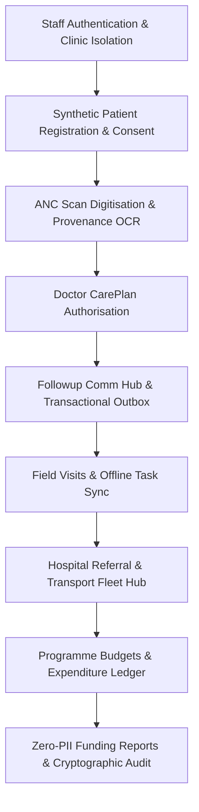

# JananiSetu — Final Product Overview (Health-a-thon 2026)

## 1. Project Identity & Concise Description
**Project Name**: JananiSetu (జననీ సేతు — *The Maternal Bridge*)  
**Mission**: An assistive, evidence-linked care-coordination and follow-up platform empowering primary healthcare teams (ANMs, Medical Officers, Field Coordinators) to eliminate preventable maternal drop-offs between routine antenatal checkups and institutional deliveries.  
**Round 1 Promise Preserved**: Realizing closed-loop care continuity through assisted human digitisation, timely multi-lingual notifications, reliable non-emergency transport coordination, and transparent institutional funding accountability.

---

## 2. Problem Statement & Root Challenges
In rural and peri-urban India:
1. **Paper-to-Digital Gap**: Mother and Child Protection (MCP) cards are physical paper records. Field workers lack fast, evidence-linked digitisation tools that preserve handwritten context without introducing automated diagnostic errors.
2. **Follow-Up Drop-Offs**: Over 30% of high-risk or remote pregnancies miss scheduled Antenatal Care (ANC) visits due to lack of timely localized reminders, language barriers, and family caregiver communication gaps.
3. **Transport Friction**: Expectant mothers frequently delay or miss scheduled hospital evaluations due to lack of reliable, non-emergency community transport arrangements.
4. **Funding & Operational Opacity**: Government and CSR maternal welfare programmes suffer from fragmented expenditure reporting, delays in reimbursement verification, and the risk of patient PII leaks in financial claim packages.

---

## 3. JananiSetu Solution Architecture
JananiSetu bridges these gaps through an integrated operational ecosystem:
- **Clinician-Led Care Plans**: Visit dates and clinical plans can only be authorised by licensed medical officers; no AI diagnosis, prescribing, or autonomous risk scoring is permitted.
- **Evidence-Linked Human OCR Digitisation**: Dual-view comparison console pairing original scans with extracted text bounding boxes, requiring human confirmation before any administrative changes are staged.
- **Closed-Loop Follow-up Engine**: Transactional outbox scheduling reminders for doctor-approved dates, tracking delivery callbacks (`sent` -> `delivered` -> `read`), and escalating unacknowledged reminders to assigned field workers.
- **Workforce & Non-Emergency Transport Hub**: Roster management, community vehicle partner empanelment with driver licence/insurance verification, and clear regulatory distinction from emergency 108 ambulance systems.
- **Paise-Accurate Financial Accountability**: Exact integer-paise accounting preventing floating-point drift, anti-self-approval controls for payroll and expenses, and automated zero-PII sanitization for public funder reporting.

---

## 4. Key Functional Modules Overview

### Module Breakdown:
1. **Role-Based Security & Multitenancy**:
   - Discrete workflows for Clinic Administrator, Medical Officer (Doctor), ANM Staff Nurse, and Field Coordinator.
   - Strict tenant data isolation ensuring clinic data is never visible across clinic boundaries.
2. **Patient Registration & Privacy-Preserving Consent**:
   - Explicit recording of communication consent and language preference (Telugu, Hindi, English).
   - Instant consent revocation stops all active reminder queues immediately.
3. **ANC Card Digitisation**:
   - Supports JPG, PNG, WEBP, and PDF scans (≤5MB) with local Tesseract-5 OCR extraction and bounding box alignment.
   - Administrative change proposal queue requiring review before profile updates.
4. **Durable Follow-up Engine**:
   - Transactional outbox architecture ensuring zero lost messages during network or worker restarts.
   - Support for secondary caregiver notifications with strict privacy protections.
5. **Healthcare Workforce & Operations**:
   - Verified professional credentials (TSMC / TSNMC councils), shift rosters, and anti-self-verification checks.
   - Empaneled non-emergency transport vehicles with external 108 emergency telephone protocols.
6. **Financial Governance & Funder Transparency**:
   - Multi-tranche contract management, milestone allocations, and budget category tracking.
   - Dual-authorized payroll and transport claims with strict anti-self-approval rules.
   - Automated export of evidence packages containing zero patient PII.

