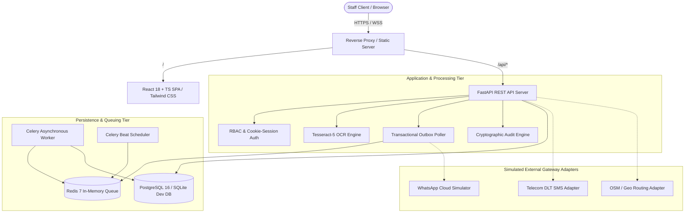

# JananiSetu — Technical Architecture & System Specification

## 1. System Topology Overview

JananiSetu is constructed as a decoupled, multi-tier web application designed for high availability, clinic-level data tenancy, and deterministic operation across edge and centralized environments.



---

## 2. Component Specifications

### 2.1 Backend Core (FastAPI & Python 3.12+)
- **Framework**: FastAPI with Pydantic v2 schemas and validation models.
- **ORM & Migrations**: SQLAlchemy 2.0 with Alembic revision tracking (`0001` through `0005`).
- **Security & Session Management**:
  - Passwords hashed using bcrypt via `passlib[bcrypt]`.
  - JWT tokens encoded with HS256, carrying unique `jti`, expiration, role, clinic, and `token_version`.
  - Token revocation tracked via `revoked_tokens` table for immediate logout invalidation.
  - Multi-worker shared rate limiting tracked through the database `events` table with rolling window aggregation.
  - Strict anti-CSRF validation verifying trusted origins, same-site cookies, and mandatory `X-Requested-With` request headers.

### 2.2 Frontend Client (React 18, TypeScript & Vite)
- **Toolchain**: Vite v6 with React 18 and `@tailwindcss/vite`.
- **State & Data Handling**:
  - Zero hardcoded patient records. All tables and counters populate dynamically via authenticated `/api/*` endpoints.
  - Secure in-memory token handling with HttpOnly cookie support.
  - Responsive layout optimized for desktop displays (1920x1080, 1366x768) and mobile devices (375x667).

### 2.3 Optical Character Recognition (OCR) Engine
- **Engine**: Tesseract 5.x (`pytesseract`) paired with `pypdfium2` and `Pillow`.
- **Pre-processing**: Grayscale conversion, adaptive Otsu thresholding, DPI normalization to 300 DPI.
- **Bounding Box Normalization**: Bounding box coordinates are captured as normalized coordinate percentages `[top%, left%, width%, height%]` relative to natural image dimensions.
- **Human Verification Loop**: Raw OCR extractions are treated as draft annotations until approved by an authorised staff member. Discrepant values generate `ChangeProposal` records.

### 2.4 Follow-up & Transactional Outbox Engine
- **Durability Guarantee**: Reminder jobs are committed within the same database transaction as the clinician's care plan.
- **Outbox Poller**: Scans `reminder_jobs` where `status == 'pending'` and `scheduled_for <= now()`.
- **Delivery State Machine**:
  ```mermaid
  stateDiagram-v2
      [*] --> pending
      pending --> sent: Outbox Worker Dispatch
      sent --> delivered: Webhook Status Callback
      delivered --> read: Patient Opens Message
      read --> acknowledged: Patient Replies 1/YES
      sent --> failed: Provider Failure / Timeout
      failed --> retrying: Exponential Backoff (1m, 5m, 25m)
      retrying --> sent: Worker Retry
      retrying --> dead_letter: Exceeded Max Retries (3)
      dead_letter --> pending: Operator Manual Resend
  ```
- **Escalation**: Unacknowledged reminders past due offset trigger automated creation of a clinic `Task` assigned to the designated ANM or field coordinator.

### 2.5 Financial & Accounting Core
- **Paise Precision**: All monetary values are represented as integer paise (`amount_paise = int(round(rupees * 100))`) to eliminate floating-point drift.
- **Budget Tracking**: Dual-entry accounting tracking `allocated`, `committed`, `incurred`, `approved`, `paid`, and `reimbursed` amounts across 7 statutory categories (`salary`, `travel`, `transport`, `clinical_services`, `diagnostics`, `technology`, `administration`).
- **Segregation of Duties**: Enforced dual-authorization on payroll and expense vouchers (`creator_id != approver_id`).

---

## 3. Data Tenancy & Clinic Isolation
Every database model containing operational or clinical data inherits a mandatory `clinic` column indexed with `ix_<table>_clinic`:
```python
class BaseClinicModel(Base):
    __abstract__ = True
    clinic: Mapped[str] = mapped_column(String(80), nullable=False, index=True)
```
- Query filters automatically restrict tenant scope: `select(Model).where(Model.clinic == current_user.clinic)`.
- Cross-clinic access attempts generate immediate `404 Not Found` or `403 Forbidden` responses.

